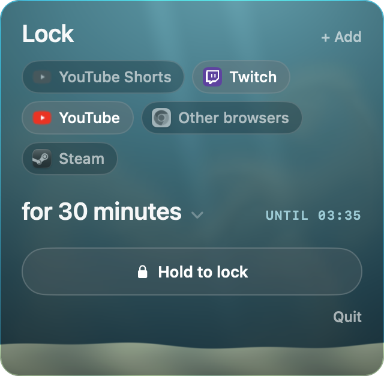
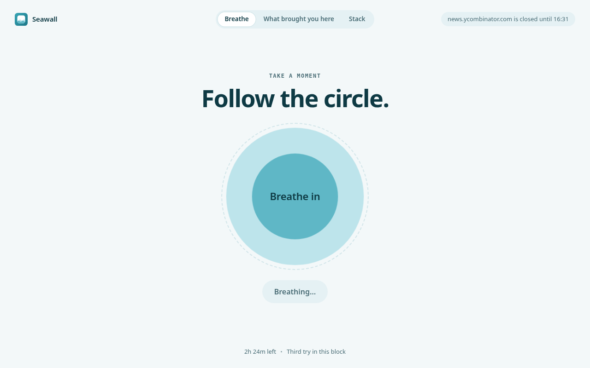

# Seawall

A lock for websites and apps on macOS. Hold the lock for a second, and Shorts, Twitch and games stay closed until evening. No changing your mind five seconds later.

A free, open-source alternative to Cold Turkey Pro and Freedom.

## What it looks like

<p align="center">
  
  &nbsp;
  
</p>

- A lock in the menu bar: pick a list, pick how long, then press and hold "Hold to lock". Holding instead of clicking means no block starts by accident. Right above the button it says exactly what will be locked and until when.
- Lists hold what you lock, like Work or Evening, each with its own icon and colour. The menu shows them as cards; the Seawall window edits them. Tick what's blocked, and add a site, an app or a category from one search box.
- How long: 25 minutes, 1 hour or 2 hours in one tap. More lengths and "until" times (end of the workday, tonight, tomorrow morning, any time up to a week ahead) are under More. Switch on breaks to work in 25-minute rounds with 5 minutes off.
- Blocks stack. Twitch until tonight, then YouTube for an hour on top. A new block only adds to what's blocked; it never shortens the ones already running. A running block can get stricter (30 more minutes, another site, app or list) but never looser.
- Open Shorts or Twitch and the tab lands on a "Blocked until 18:00" page. Regular YouTube still works.
- Launch a game and it's closed within a second.
- Categories cover a whole kind of distraction: Games, Social, Video, News and Shopping. Games closes any app macOS lists as a game, even ones you've never added.
- Or block the whole web: switch a list to "Every site except these" and keep a few sites open, like your docs or a work tool.
- Leaving early is honest friction. Flexible blocks take a 10-minute wait, Firm ones 30 minutes, Locked ones can't be left at all. After the wait you get 2 minutes to end the block; do nothing and it keeps going. Pick the default in Settings, or change it for one block right under the hold button.
- Schedules start a list on their own, like Work on weekdays from 9:00 to 12:00. Set them inside the list, or paint them on the week grid under Schedules.
- A Focus can start a block too: a Shortcuts automation opens a link like `seawall://lock?list=Work&until=18:00` (or `for=2h`) when the Focus turns on. Each list walks you through it. The same link works from Raycast, Alfred or Terminal, and never locks for more than 12 hours.
- Today shows time locked, tries caught and days in a row.
- A blocked tab lands on a calm page that offers a way out of the urge: one slow breath, a question about what brought you here, or a 30-second game of stacking blocks. Pick which one in Settings under Blocked page: Random (the default), Breathe, What brought you here, Stack, or All together with a switcher at the top. The page shows the site and the time left, and keeps only its own counters (breaths, wins and best stack) in the browser.
- Settings also has: the time left instead of the end time in the menu bar, a notification 5 minutes before a block ends, soft sounds, and ⌃⌥⌘L to open the menu from anywhere.

## Install

Needs macOS 14+ and the Command Line Tools (`xcode-select --install`). No Xcode required.

```bash
git clone https://github.com/NikOneZ1/seawall.git
cd seawall
make install   # builds and copies to /Applications
```

Other commands: `make run` runs from `build/`, `make test` runs the tests.

The first launch walks you through it, including macOS asking "Seawall wants to control Safari" (and Chrome, if you have it). Allow it. Without that access Seawall can't see tabs, so during a block that browser just gets closed.

## How it works

| What | How |
| --- | --- |
| Sites in Safari, Chrome, Arc, Brave and Edge | Twice a second it reads tab addresses over Apple Events (every 5 seconds for a browser in the background). If an address matches a rule, the tab is sent to a local page at `127.0.0.1:47321`. No browser extension needed. Private and Incognito windows are covered too. Arc, Brave and Edge use Chrome's scripting but haven't been tested yet. |
| Rules | `twitch.tv` blocks the domain and its subdomains. `youtube.com/shorts` blocks only that section. A few subdomains are really their own site, so `youtube.com` leaves `music.youtube.com` open unless you add it too. |
| Whole web | Every http and https address is blocked except the sites in Except, in every browser Seawall can read; the ones it can't read are closed. Pages on your own Mac (localhost, `.local` and the block page itself) are never blocked. |
| Apps | Watches app launches and closes the ones on the list. If an app doesn't quit within a second, it gets killed. With Games on, any app filed under Games (or a kind of game, like board games) is closed too, as is anything installed into a Steam or Epic library and launchers like Steam, Battle.net and Riot. |
| Other browsers | Firefox, Zen, Opera, Vivaldi and the like can't be looked into, so the "Other browsers" option closes them during a block. It only shows up when one of them is installed. |
| Several blocks | Each block keeps its own end time and attempt count. When two blocks cover the same site, the page shows the later end. |
| If you kill Seawall | While anything is blocked, a LaunchAgent (`~/Library/LaunchAgents/com.nikitaverba.FocusLock.watchdog.plist`) relaunches the app every 10 seconds and at login. Blocks are restored from disk. |
| If you change the clock | Block time runs on a monotonic clock, so moving the system time forward doesn't shorten a block. |

State lives in `~/Library/Application Support/Seawall/`. Site icons are fetched once from the site itself (`/apple-touch-icon.png` or `/favicon.ico`) and cached in `Icons/` there; nothing else leaves your Mac.

## Uninstall

In Settings, press **Uninstall Seawall…**. It removes your lists and history, settings, site icons, the watchdog LaunchAgent, Open at login and the permission to read browser tabs, can move the app to the Trash, and quits. Like Quit, it only works when no block is running (or about to start on schedule); it's never a faster way out than leaving early.

By hand: quit Seawall from its menu (Quit is on when no block is running), then:

```bash
launchctl bootout gui/$(id -u)/com.nikitaverba.FocusLock.watchdog 2>/dev/null
rm -f ~/Library/LaunchAgents/com.nikitaverba.FocusLock.watchdog.plist
rm -rf /Applications/Seawall.app "$HOME/Library/Application Support/Seawall"
defaults delete com.nikitaverba.FocusLock 2>/dev/null
tccutil reset AppleEvents com.nikitaverba.FocusLock
```

The last line forgets the permission to control Safari, Chrome and the other browsers. The names still say FocusLock because that was the app's first name. The full list of what Seawall writes, and how to check it's all gone, is in [docs/UNINSTALL.md](docs/UNINSTALL.md).

## Honest limits

Seawall protects you from an impulse, not from a determined person with a terminal. You can get around it by deleting the LaunchAgent, revoking access in System Settings or editing the files. But that takes minutes of deliberate effort, not five seconds.

## Next

- [x] Schedules (weekdays 10:00–18:00)
- [x] Daily stats (Today)
- [x] Icon
- [ ] A signed release

## License

Copyright © 2026 Nikita Verba. Seawall is free software under the GNU General Public License v3.0: you can use, change and share it, and anything you release that's built on it has to stay open under the same license. See [LICENSE](LICENSE).
