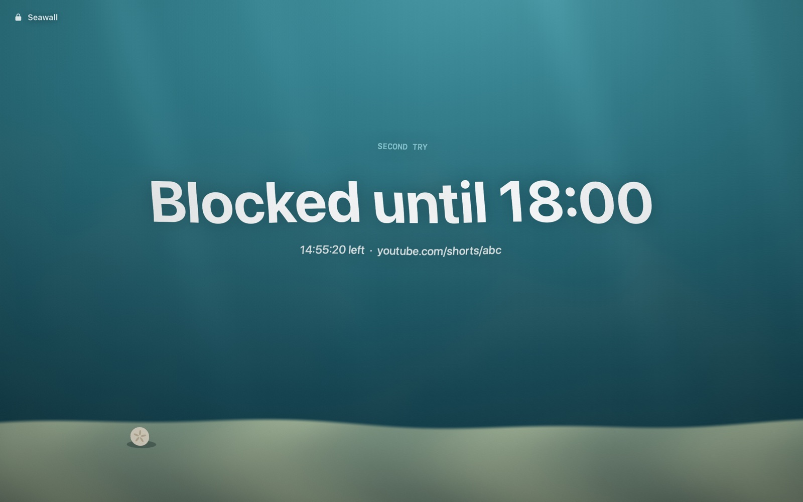

# Seawall

A lock for websites and apps on macOS. Hold "Lock" for a second, and Shorts, Twitch and games stay closed until evening. No changing your mind five seconds later.

A free, open-source alternative to Cold Turkey Pro and Freedom.

## What it looks like

<p align="center">
  
  &nbsp;
  
</p>

- A lock in the menu bar: pick sites and apps, pick how long, then press and hold "Hold to lock". Holding instead of clicking means no block starts by accident.
- How long: 15 minutes to 4 hours, until a set time (tonight, tomorrow at 15:00, up to a week ahead), or in rounds: 4 × 25 minutes with 5-minute breaks, when everything opens.
- Save what you lock as a list, like Work or Evening ("Save what's on as a list…" under + Add). Saved lists sit as small chips under "Lock"; tap one to switch to it.
- Blocks stack. Twitch until tonight, then YouTube for an hour on top. A new block only adds to what's blocked; it never shortens the ones already running.
- Open Shorts or Twitch and the tab lands on a "Blocked until 18:00" page. Regular YouTube still works.
- Launch a game and it's closed within a second.
- One tap covers a whole kind of distraction: under "+ Add" there are Games, Social, Video, News and Shopping, plus popular single sites. Games closes any app macOS lists as a game, even ones you've never added.
- Or block the whole web. "Whole web" sits under "+ Add" with the groups; once it's on, an Except row lets you keep a few sites open, like your docs or a work tool.
- There's no stop button. You can ask to leave early and wait 10 minutes; then Seawall asks "End the block now?" for 2 minutes. Don't answer and the request expires. Every block has its own way out. The line under the duration ("Leave early after 10 min") switches it to a 30-minute wait, or no way out at all.
- Schedules start a saved list on their own, like Work on weekdays from 10:00 to 18:00 (Settings → Schedules).
- A Focus can start a block too: a Shortcuts automation opens a link like `seawall://lock?list=Work&until=18:00` (or `for=2h`) when the Focus turns on. Settings has the steps and a link to copy. The same link works from Raycast, Alfred or Terminal, and never locks for more than 12 hours.
- Settings also has: the time left instead of the end time in the menu bar, a notification 5 minutes before a block ends, soft sounds when one starts and ends, and ⌃⌥⌘L to open the menu from anywhere.
- When a block ends, it tells you how many times you tried to break it.

## Install

Needs macOS 14+ and the Command Line Tools (`xcode-select --install`). No Xcode required.

```bash
git clone https://github.com/NikOneZ1/seawall.git
cd seawall
make install   # builds and copies to /Applications
```

Other commands: `make run` runs from `build/`, `make test` runs the tests.

The first launch walks you through it, including macOS asking "Seawall wants to control Safari" (and Chrome, if you have it). Allow it. Without that access Seawall can't see tabs, so during a block that browser just gets closed.

## How it works

| What | How |
| --- | --- |
| Sites in Safari, Chrome, Arc, Brave and Edge | Twice a second it reads tab addresses over Apple Events (every 5 seconds for a browser in the background). If an address matches a rule, the tab is sent to a local page at `127.0.0.1:47321`. No browser extension needed. Private and Incognito windows are covered too. Arc, Brave and Edge use Chrome's scripting but haven't been tested yet. |
| Rules | `twitch.tv` blocks the domain and its subdomains. `youtube.com/shorts` blocks only that section. A few subdomains are really their own site, so `youtube.com` leaves `music.youtube.com` open unless you add it too. |
| Whole web | Every http and https address is blocked except the sites in Except, in every browser Seawall can read; the ones it can't read are closed. Pages on your own Mac (localhost, `.local` and the block page itself) are never blocked. |
| Apps | Watches app launches and closes the ones on the list. If an app doesn't quit within a second, it gets killed. With Games on, any app filed under Games (or a kind of game, like board games) is closed too, as is anything installed into a Steam or Epic library and launchers like Steam, Battle.net and Riot. |
| Other browsers | Firefox, Zen, Opera, Vivaldi and the like can't be looked into, so the "Other browsers" option closes them during a block. It only shows up when one of them is installed. |
| Several blocks | Each block keeps its own end time and attempt count. When two blocks cover the same site, the page shows the later end. |
| If you kill Seawall | While anything is blocked, a LaunchAgent (`~/Library/LaunchAgents/com.nikitaverba.FocusLock.watchdog.plist`) relaunches the app every 10 seconds and at login. Blocks are restored from disk. |
| If you change the clock | Block time runs on a monotonic clock, so moving the system time forward doesn't shorten a block. |

State lives in `~/Library/Application Support/Seawall/`. Site icons are fetched once from the site itself (`/apple-touch-icon.png` or `/favicon.ico`) and cached in `Icons/` there; nothing else leaves your Mac.

## Uninstall

Quit Seawall from its menu (the Quit button shows when no block is running), then:

```bash
launchctl bootout gui/$(id -u)/com.nikitaverba.FocusLock.watchdog 2>/dev/null
rm -f ~/Library/LaunchAgents/com.nikitaverba.FocusLock.watchdog.plist
rm -rf /Applications/Seawall.app "$HOME/Library/Application Support/Seawall"
tccutil reset AppleEvents com.nikitaverba.FocusLock
```

The last line forgets the permission to control Safari, Chrome and the other browsers. The names still say FocusLock because that was the app's first name.

## Honest limits

Seawall protects you from an impulse, not from a determined person with a terminal. You can get around it by deleting the LaunchAgent, revoking access in System Settings or editing the files. But that takes minutes of deliberate effort, not five seconds.

## Next

- [x] Schedules (weekdays 10:00–18:00)
- [ ] Daily stats
- [x] Icon
- [ ] A signed release

## License

Copyright © 2026 Nikita Verba. Seawall is free software under the GNU General Public License v3.0: you can use, change and share it, and anything you release that's built on it has to stay open under the same license. See [LICENSE](LICENSE).
